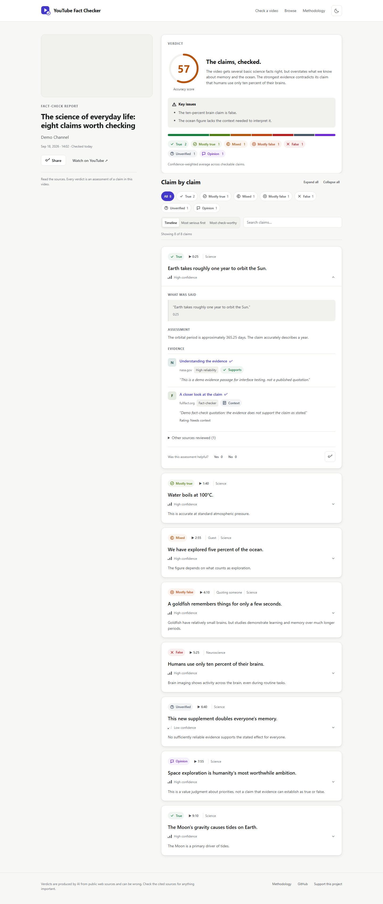

# YouTube Fact Checker

Paste a YouTube URL to get an evidence-backed report on the factual claims in its transcript.

[](https://github.com/LLRHook/youtube-fact-checker/actions/workflows/ci.yml)



## Features

- Claim extraction with check-worthiness ranking.
- Brave LLM Context evidence and Google Fact Check results.
- Reliability-ranked sources.
- Seven-point verdicts with quote-verified citations.
- Live processing progress and claims as they are checked.
- Saved report pages with timestamp seeking in the video player.
- Browse and channel pages.
- Feedback on individual assessments.
- Cost tracking and a daily processing budget.

## How it works

```text
YouTube URL -> timestamped transcript -> claim extraction
    -> Brave LLM Context + Google Fact Check -> evidence-based verdicts
    -> citation checks + summary -> SQLite -> live progress / saved report
```

## Accuracy safeguards

- Grounding check: cited quotes must match the retrieved evidence; invalid and duplicate citations are dropped.
- Unverifiable over guessing: a checkable verdict without valid citations or declared general knowledge becomes unverifiable with low confidence.
- General-knowledge cap: uncited assessments based on general knowledge have at most medium confidence.
- Low-reliability cap: assessments citing only low-reliability sources have low confidence.
- Prompt-injection guard: the model is instructed to ignore instructions inside untrusted evidence.
- Refusal fallback: model refusals return an unverifiable assessment instead of a guessed verdict.

## Cost

Per video, roughly $0.30-0.60 with Claude Sonnet 5.5 and Brave Search, depending on claim count; set `DAILY_BUDGET_USD` to bound daily processing spend.

## Quick start

Use Python 3.13. On Windows, from the repository root:

```powershell
python -m venv .venv
.venv\Scripts\Activate.ps1
pip install -r requirements-dev.txt
Copy-Item .env.example .env
```

Add your provider keys to `.env`, then start the server:

```powershell
uvicorn backend.main:app --reload
```

Open [localhost:8000](http://localhost:8000). For a seeded demo, run this before starting the server:

```powershell
python scripts/seed_demo.py data/demo.db
$env:DATABASE_PATH = "data/demo.db"
uvicorn backend.main:app --reload
```

## Configuration

See [.env.example](.env.example) for all settings and defaults.

| Variable | Purpose |
|---|---|
| `ANTHROPIC_API_KEY` | Claude claim extraction, verdicts, and summaries |
| `BRAVE_API_KEY` | Web evidence retrieval |
| `GOOGLE_FACTCHECK_API_KEY` | Google Fact Check retrieval |
| `VERDICT_MODEL` | Model used to assess claims |
| `DAILY_BUDGET_USD` | Daily processing budget; excess work is queued |
| `MAX_VIDEO_DURATION_SECONDS` | Maximum accepted video duration |
| `TRANSCRIPT_PROXY_URL` | Proxy for transcript and video metadata access |

YouTube often blocks cloud IPs, so production may need a residential proxy configured through `TRANSCRIPT_PROXY_URL`.

## Tests

```powershell
ruff check backend tests scripts
pytest tests/unit tests/services tests/integration -q
python -m playwright install chromium
pytest -m e2e tests/e2e -q
python scripts/screenshots.py
```

The browser tests and screenshot script start an isolated server with seeded reports. If system temp is blocked, use `--basetemp=.pytest_tmp` for pytest.

## Deployment

Build the Docker image or deploy it on Railway. Mount a persistent volume and set `DATABASE_PATH` to a database file on that volume. The container honors `PORT` (default `8000`); `/api/health` is the health check endpoint. Configure provider keys and the daily budget in the deployment environment.

## Limitations

- Videos need accessible captions and must fit the configured duration limit.
- Caption errors and approximate speaker attribution can affect extracted claims.
- Verdicts are automated evidence assessments; read the cited sources before relying on them.
- Search coverage, provider quotas, and network access affect evidence quality and processing availability.
- Prompt instructions and citation checks reduce errors but cannot eliminate them.
