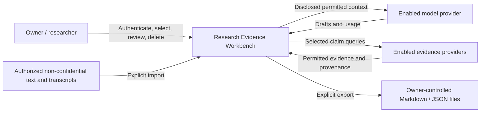
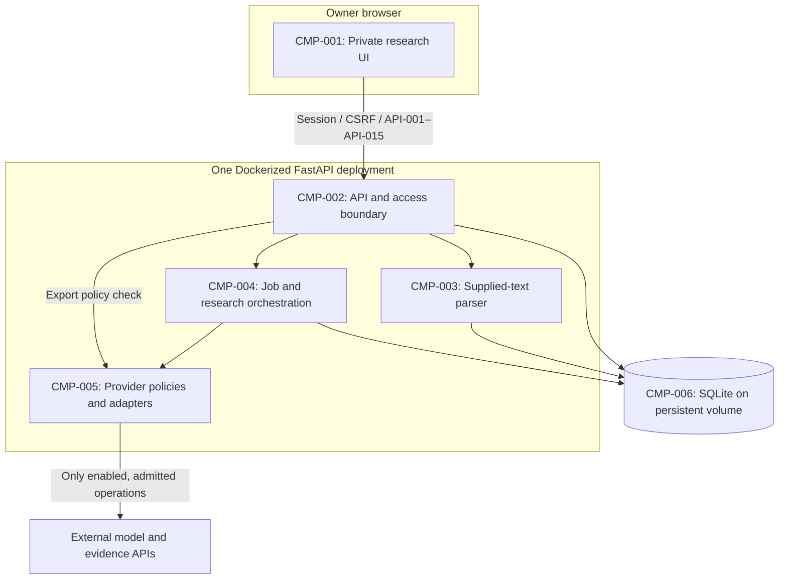
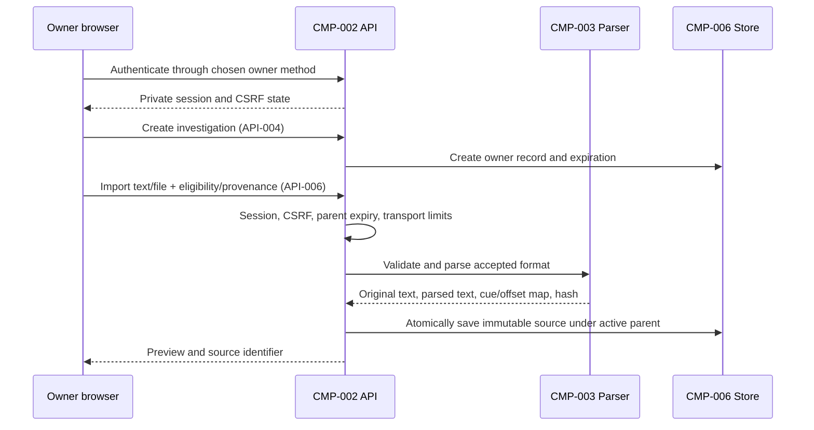

# Architecture — Research Evidence Workbench

Related: [SRS](SRS.md) · [Data Contracts](DATA_CONTRACTS.md)
Status: Approved pilot scope and selected engineering defaults; detailed implementation remains a draft design. No application changes have been made.

## 1. Goals and quality drivers

| Driver | Source | Architectural response |
|---|---|---|
| One private owner | FR-001, NFR-005 | Server-enforced session/ownership boundary across pages, APIs, files, exports, and jobs |
| Authorized supplied material | FR-003–FR-005, CON-004 | Local parser and immutable provenance; source URLs remain references |
| Human-reviewed research | FR-007, FR-009–FR-013, NFR-004 | Frozen claim selection, evidence references, report revisions, explicit draft/review state |
| Bounded spend and execution | FR-017–FR-018, NFR-001, CON-002 | One durable executor; transactionally reserved operation funds; usage reconciliation |
| Retention and deletion | FR-014–FR-015 | Access-time expiration, cascading active-content purge, worker fencing, content-free accounting |
| Provider-use limits | FR-008, IR-002 | Disabled-by-default unverified integrations; policy filtering at retrieval, persistence, and export |
| Existing technology | CON-001 | FastAPI plus existing static UI, Python services, SQLite, Docker |

Performance/quality thresholds are SRS TBD-003. The owner-session design, 1 MiB byte ceiling, no-automatic-backup policy, fixed expiry and core-flow accessibility target are now approved. Provider entitlements, token/parser sizing, physical-copy and accounting/recovery limits remain explicit TBDs; diagrams are not claims that those choices are resolved.

## 2. Constraints

The approved scope is defined by CON-001–CON-004, NFR-001–NFR-002, and the pilot phase in SRS §1.8. Preserve the existing repository's work. Reuse service logic where its behavior satisfies the new requirements; do not assume legacy anonymous routes or scraping can be carried into the private pilot.

The proposed budget allocation is recorded in SRS §3.6 and PRODUCT_FEASIBILITY.md. Actual hosting consumption and the price of the necessary provider rights are unresolved. No additional hosted database, queue, authentication subscription, or object store is required by this design. A paid service must be justified against the allowance before adoption.

## 3. System context (C4 level 1)



No automated YouTube/media acquisition is in the pilot context. Reference links can appear in supplied provenance or authorized citations without becoming ingestion connectors. Export recipients do not receive access to the application. Model/search providers remain external recipients with their own actual contracts and retention limits.

## 4. Containers and components (C4 level 2)



| Id | Component | Responsibility | Technology | Owns data | Exposes | Depends on |
|---|---|---|---|---|---|---|
| CMP-001 | Private research UI | Import preview, source/claim inspection, selection, progress, report review/export/delete | Existing HTML/JavaScript/CSS | Browser UI state only; no persistent investigation content in localStorage | Owner browser screens | CMP-002 |
| CMP-002 | API and access boundary | Authentication, CSRF, ownership/expiry checks, contract validation, exports and deletion | FastAPI/Python | ENT-001 authentication association | API-001–API-015 | CMP-003–CMP-006 |
| CMP-003 | Supplied-text parser | Decode/validate TXT/SRT/VTT/paste, preserve original and location mapping, enforce import bounds | Python service | Produces ENT-003; no source-platform credentials | Internal import operation | CMP-006 |
| CMP-004 | Job and research orchestration | Durable jobs, extraction, frozen claim selection, research/assessment, revision creation, usage admission/settlement | Python async services, one executor | ENT-004, ENT-006, ENT-008 lifecycle; ENT-009 accounting operations | Internal executor and API-010 status | CMP-005, CMP-006 |
| CMP-005 | Provider policies and adapters | Check intended-use rights and dated prices, call permitted APIs, validate/filter evidence, disclose handling | Existing Anthropic/httpx adapters, proposed policy layer | ENT-007 configuration; produces permitted ENT-005 | Internal provider operations and export filters | External APIs; CMP-006 |
| CMP-006 | Persistence | Ownership/expiry transactions, immutable content/revisions, executor lease, usage ledger, purge | SQLite/aiosqlite on persistent volume | System of record for ENT-001–ENT-009 except credential secrets | Repository/transaction operations | Persistent disk |

These are logical components, not six deployed services. A single service plus SQLite fits the approved scale. Owner authentication is the approved ADR-008 mechanism (resolved TBD-008). Session secret storage follows that scheme and is not defined by an improvised login form in these documents.

## 5. Runtime views

### 5.1 Private access and supplied-material import (FR-001–FR-005)



Invalid eligibility/format/size fails without provider calls. Input is bounded before full buffering; byte and token ceilings are TBD-005. Uploaded filenames are labels, never storage paths. All returned text is safely rendered as data. A source URL is never fetched as a side effect.

### 5.2 Extraction and selected-claim research (FR-006–FR-008, FR-016–FR-018)

```mermaid
sequenceDiagram
    participant O as Owner browser
    participant A as CMP-002 API
    participant D as CMP-006 Store
    participant J as CMP-004 Executor
    participant X as CMP-005 Adapters
    O->>A: Request extraction with idempotency/disclosure version
    A->>D: Check active parent, policy/pricing; admit job transactionally
    A-->>O: Job reference (API-008)
    J->>D: Acquire sole executor lease and snapshot
    J->>D: Reserve bounded paid operation
    J->>X: Extract from permitted source context
    X-->>J: Candidate output and usage
    J->>D: Settle usage; validate/store quoted candidates
    O->>A: Inspect/correct candidates (API-009)
    O->>A: Submit frozen selection (API-011)
    A->>D: Validate selection and job admission
    J->>D: Lease job; reserve each paid operation
    J->>X: Query enabled evidence providers
    X-->>J: Policy-filtered evidence and outcomes
    J->>D: Save permitted evidence and settle usage
    J-->>A: Persisted progress is available
    O->>A: Poll status (API-010)
    A-->>O: Explicit progress/outcome
```

Both extraction and research consume budget. At most one paid job executes under the deployment-wide lease. A job references one immutable document and a frozen claim-revision selection; multiple documents can exist in an investigation, but combining them in a job is not this contract. Provider-specific checks apply again before each external call so queued work cannot rely on an expired entitlement or price schedule.

Admission and execution reservations must account for total bounded work, including allowed retries and output token limits. Extraction/research cannot start when complete worst-case admission cannot fit the configured allowance. Per-operation reservation settlement does not silently create capacity for an unbudgeted next stage.

### 5.3 Evidence validation, researcher review, and export (FR-009–FR-013)

```mermaid
sequenceDiagram
    participant J as CMP-004 Research
    participant X as CMP-005 Policy/adapters
    participant D as CMP-006 Store
    participant O as Owner browser
    participant A as CMP-002 API
    J->>X: Admitted draft-assessment operation
    X-->>J: Structured suggestions and usage
    J->>J: Validate evidence IDs and quote matches
    J->>D: Store draft revision with provenance/limitations
    O->>A: Read source, evidence, report (API-007/API-012)
    A-->>O: Draft and source-coverage labels
    O->>A: Submit edits + explicit review confirmation
    A->>D: New immutable report revision
    O->>A: Explicit Markdown/JSON export (API-013)
    A->>X: Recheck current export/retention policy
    X-->>A: Permitted fields and omission limitations
    A-->>O: Download selected revision; no-store
```

Quote validation verifies actual received evidence, not a model-generated source name or fabricated URL. It does not prove contextual support; that distinction remains visible to the researcher. Professional fact-check ratings retain their original attribution and date, separately from the product's assessment. No video/channel aggregate truth score is required. Exports can include an unreviewed draft only with its draft state preserved. A changed reviewed report becomes a new draft unless review is explicitly reconfirmed.

### 5.4 User deletion and expiration (FR-014–FR-015)

```mermaid
sequenceDiagram
    participant O as Owner browser / expiry guard
    participant A as CMP-002 API
    participant D as CMP-006 Store
    participant J as CMP-004 Executor
    O->>A: Delete case or access expired case
    A->>D: Fence executor and close admission for case
    A->>J: Cancel queued/running local work
    A->>D: Purge active case content; detach usage links
    D-->>A: Active-content deletion committed
    A-->>O: Delete success or expired-resource refusal
    J->>D: Late provider response / accounting settlement
    D-->>J: Content write denied; content-free usage settlement allowed
```

Serialize deletion against provider-call admission so no new call begins after successful deletion. An already-started request may complete externally; cancel its local task when possible and reject its content writes. Fencing cannot un-send a request. Usage settlement identifies only the retained operation ledger key and does not recreate removed document/job rows. Review/export checks independently enforce expiry, even when periodic cleanup has not yet run.

Immediate active deletion includes content-bearing temporary files and in-memory caches under application control. Physical volume/WAL/backup erasure details must be settled in TBD-006 before the deletion promise is deployed. Exported files and external provider copies are outside this promise and explicitly disclosed.

### 5.5 Provider failure, unknown charges, and restart (FR-010, FR-016–FR-018)

```mermaid
sequenceDiagram
    participant J as CMP-004 Executor
    participant D as CMP-006 Store
    participant X as CMP-005 Provider adapter
    J->>D: Reserve operation; check active parent and lease
    J->>X: Paid request
    alt Known response with usage
        X-->>J: Result or controlled provider error
        J->>D: Settle known usage and result/outcome
    else Timeout with ambiguous billing
        X-->>J: Uncertain provider outcome
        J->>D: Mark reservation uncertain; job partial/failed
    else Service restart
        Note over J,D: Old executor stops; startup checks durable lease/jobs
        J->>D: Mark abandoned running job interrupted
    end
    Note over J,D: No silent paid replay; explicit resubmission needs fresh admission
```

Automatic SDK retries/fallbacks are part of paid operations and must be bounded/rated or disabled. Do not assume HTTP failures are unbilled. Restart recovery restores status from SQLite, fences the prior execution generation, and requires explicit resubmission for interrupted paid work. A lease timeout alone must not allow two live executors; the proposed pilot runs one service replica/process and verifies exclusivity before advancing work.

## 6. Deployment view

Proposed pilot deployment: one Docker service hosting the static UI, FastAPI, one background executor, and maintenance routines; one persistent SQLite volume. Local development uses the same stack with isolated fixture data. No production deployment is authorized by this documentation task.

Railway is the existing hosting candidate. A region, exact resource size, host retention/physical-copy facts and measured operating cost are not inferred from a reachable URL. The approved owner-session design is ADR-008; automatic content backups are disabled for this pilot. Use a separate pilot database and configured private-mode routes so historical public reports do not become accidentally accessible or lose their provenance. Existing public-site operation is a separate deployment decision.

Browser traffic terminates at HTTPS hosting ingress; only the authenticated API can reach investigation storage. Model/evidence credentials remain server-side. The public liveness endpoint may report service process availability but cannot certify research capability. A capability check must separately report configuration/policy/pricing readiness without exposing secrets; a permitted live research trial is still needed for operational verification.

Scale unit: the single deployment at the approved concurrency. Additional replicas, multi-user access, a distributed queue, or a new database require revised requirements and a cost model. Hosting shutdown at a configured platform spending limit can make all views unavailable; do not promise continuous read/export availability after the host itself is stopped.

## 7. Cross-cutting concepts

### 7.1 Security (authn, authz, secrets, encryption in transit/at rest)

- Implement the approved ADR-008 authentication/recovery design; only the configured owner is permitted. No anonymous registration or bearer share link is in scope.
- Enforce session validation, server-side ownership, expiry, and mutation CSRF centrally and again at background admission/write boundaries. Do not rely on hidden buttons or opaque identifiers alone.
- Approved session cookie attributes: HttpOnly, Secure outside localhost, and SameSite=Strict; logout invalidates server-side state. The maximum session lifetime is eight hours; bounded login-throttle parameters are set and tested in the auth ticket.
- Use HTTPS to hosting/provider services; validate certificates. At-rest volume/backup encryption facts require deployment verification, not a documentation assumption.
- Escape imported/provider text; no raw HTML execution or filename-based paths. Restrict links to intended schemes and prevent secret-bearing URLs. External full-page fetch is not an implicit feature.
- Treat source/evidence as untrusted model context. Ignore embedded instructions; only schema-validated outputs can become records. Provider/model output cannot change access, retention, policy, or budget settings.
- Keep provider credentials in the existing environment/secret mechanism; do not include them in documents, exports, logs, source tables, or browser requests.

### 7.2 Observability (logs, metrics, traces, alerts)

Persist job status/progress and content-free counters through ENT-008/ENT-009. Log correlation IDs, safe outcome categories, provider/model/price versions, stage durations, and aggregate usage. NFR-006 excludes raw queries, transcripts, evidence, credentials, session tokens, and raw exception bodies. Deleted investigations lose content-bearing references; accounting persists only with opaque operation identifiers.

Owner budget view distinguishes known charges, reservations, uncertain billing, and remaining application allowance. Hosting/provider account alarms and invoice reconciliation are separate operator tasks; the application is not the source of truth for unrelated account charges. Metrics become baseline evidence for TBD-002/TBD-003.

### 7.3 Error handling and resilience (timeouts, retries, idempotency)

Use Data Contracts §5 controlled errors and durable ENT-008 states. Idempotency keys bind accepted mutations/jobs to body hashes; duplicates cannot silently repeat paid work. Immutable snapshots and optimistic revision checks prevent a running job from observing later edits.

Bound token output, search requests, timeouts, retries, and any fallback model price. Unknown categories cannot be rated optimistically. Uncertain provider response/billing retains its reservation until reconciled. No in-memory-only task map serves as the authoritative job state.

### 7.4 Configuration and environments

Approved design responsibilities, not newly implemented environment variables:

| Responsibility | Required setting/basis |
|---|---|
| Private mode | Approved owner passphrase/session mechanism and no public-content routes |
| Data store | Pilot database/volume distinct from legacy data |
| Input bounds | NFR-002 plus byte/token/parser limits from TBD-005 |
| Provider enablement | ENT-007 entitlement, use fields, attribution, price and disclosure versions |
| Spend controls | CON-002-derived variable allowance and actual provider account limits |
| Execution | One process/replica, one durable executor, bounded retry rules |
| Retention | FR-015 deadline checks, physical cleanup/backup/ledger rules from TBD-006 |

Existing `DAILY_BUDGET_USD`, `MAX_CLAIMS_PER_VIDEO`, and video queue behavior do not independently satisfy monthly total operating costs or the new selected-claim/job contract. Existing model identifiers are retained as candidates; no new model is selected by this document. Price handling needs review: `backend/services/llm.py` currently prices Sonnet cache reads at $0.20/MTok, while the research memo recorded $0.10/MTok from the checked pricing page. This is a reported reconciliation item, not a code edit or permission to change models.

### 7.5 Data management (backups, migrations, retention enforcement)

Implement transactional parent/child ownership, immutable document/report identities, and job fencing. Run purge at startup before access/work, periodically while active, and before executing queued jobs; read/export checks enforce expired-resource refusal independently. Physical cleanup must not leave recoverable content in application-controlled temporary files or unmanaged caches.

The active-deletion promise and backup recovery can conflict if restored backups reintroduce content. Resolve physical SQLite/WAL cleanup and backup strategy in TBD-006. If backups exist, use a content-free deletion/expiry reconciliation method that survives restoration before private reads resume; its retained identifiers and lifetime require a documented policy. Do not restore expired/deleted investigations without enforcing those rules. No backup retention period or recovery SLA is invented here.

Usage ledger rows retain non-content cost evidence and detach deleted job links. Provider-use changes or evidence expiration can invalidate current evidence display/export; report revisions remain labeled unavailable/restricted as appropriate. Separate source transcript rights from evidence-provider rights. New pilot data is not automatically migrated from historic scraped reports.

## 8. Architecture decisions

### ADR-001 — Supplied material as the pilot input

Status: Accepted scope; implementation proposed.
Context: FR-003–FR-005, CON-004; the existing video lookup can be blocked before research begins.
Decision: Process authorized pasted text and transcript files locally; retain optional source URLs only as provenance references.
Alternatives: arbitrary-video scraping requires an unestablished permission/reliability route; media uploads add unapproved processing/storage scope.
Consequences: More user input effort; platform extraction is removed from the pilot's critical path. Uploaded rights still need an appropriate basis.

### ADR-002 — Preserve the existing service stack

Status: Accepted scope; detailed deployment proposed.
Context: CON-001, CON-002, NFR-001.
Decision: One FastAPI/Docker deployment with the existing static frontend and SQLite; separate logical components rather than microservices.
Alternatives: framework/database/queue replacement adds migration/operating cost without an approved scale requirement.
Consequences: Reuse Python services and test layers; explicit job durability, access control, and migrations still require work. SQLite is not an excuse to skip concurrency invariants.

### ADR-003 — Private reports and export-based sharing

Status: Accepted scope and owner-session mechanism; implementation pending.
Context: FR-001, FR-013, NFR-005, CON-003.
Decision: Owner-only content and explicit Markdown/JSON attachment downloads; no hosted public reports or share tokens.
Alternatives: anonymous public reports violate approved privacy defaults; team/link sharing is later scope.
Consequences: Simpler access boundary; external copies cannot be revoked or deleted by the application.

### ADR-004 — Durable jobs with conservative retry/recovery

Status: Proposed.
Context: FR-016–FR-018, NFR-001.
Decision: SQLite is authoritative for snapshots, executor lease/fencing, status, reservations, and settlements. Interrupted paid work is not silently replayed.
Alternatives: existing in-memory job map loses authoritative state on restart; a hosted broker is unnecessary for one executor.
Consequences: Extra transaction/state logic; owner may need to resubmit an interrupted job after billing reconciliation.

### ADR-005 — Provider use policy is an execution dependency

Status: Proposed mechanism implementing approved scope; values TBD-001.
Context: FR-008, FR-013, IR-002, CON-002.
Decision: Disable integrations without documented rights for the exact useful workflow; enforce permitted fields and retention/export limits through CMP-005.
Alternatives: a functioning API key or a short local TTL does not establish permission; silently substituting a scraper undermines the product constraint.
Consequences: Some integrations may remain unavailable or need an alternative license/source. Public list prices do not establish the cost of required rights.

### ADR-006 — Immutable provenance and researcher-reviewed revisions

Status: Proposed mechanism implementing approved workflow.
Context: FR-005, FR-007, FR-009–FR-013.
Decision: Freeze source identity, claim selection, evidence references, and report revisions; distinguish quote matching, contextual review, and editorial conclusion.
Alternatives: overwriting source/claim/report data loses reproducibility; whole-video or creator truth percentages obscure coverage and uncertainty.
Consequences: More versioned records within retention; clearer inspection/export semantics without implying professional certification.

### ADR-007 — Deletion fences work while accounting survives

Status: Proposed; physical storage/backup rules TBD-006.
Context: FR-014–FR-015, FR-018.
Decision: Close admission, cancel/fence local work, purge active content, and detach content-free usage. Late results settle accounting only.
Alternatives: deleting usage refunds incurred costs; soft-deleted readable content or a late response repopulating it violates immediate deletion.
Consequences: Deletion has transaction/executor coordination and external-copy limitations. Fixed creation-based expiration and no automatic content backups are approved defaults; neither creates a sliding retention rule or an external physical-erasure guarantee.

### ADR-008 — Single-owner passphrase and revocable server sessions

Status: Accepted by stakeholder backlog/defaults approval on 2026-10-14; not implemented.
Context: FR-001, NFR-005, resolved TBD-008, CON-002.
Decision: One configured Argon2 owner-passphrase hash through a verified/pinned `pwdlib[argon2]` dependency; opaque high-entropy cookie tokens with hash-only SQLite session storage; eight-hour maximum; Secure/HttpOnly/SameSite=Strict outside localhost; session-bound CSRF; generic bounded login throttling. Logout and credential rotation revoke sessions. Recovery is operator rotation of the configured hash, with no signup/email/OAuth service.
Alternatives: A hosted identity subscription adds an unapproved account dependency; JWTs need separate revocation machinery for the agreed behavior.
Consequences: No new paid identity service. The auth implementation must verify dependency support, same-origin login handling, token entropy/hash treatment, rate limits, and all legacy/pilot access boundaries. Approval is a design decision, not a claim that existing APIs are private.

## 9. Risks and technical debt

| Risk | Likelihood | Impact | Mitigation | Related |
|---|---|---|---|---|
| Provider rights for retained/exported evidence are not established | Known unresolved | Blocks affected useful research workflow | Verify actual terms, record permitted policy; keep integration disabled | TBD-001, ADR-005 |
| Required entitlement or hosting exceeds allowance | Unmeasured | Pilot may not fit budget | Measure real jobs/hosting and contract price; refuse spend without admission | TBD-002, CON-002 |
| Source/claim context or evidence scope is misrepresented | Model-dependent | Research error | Exact provenance, chunk-coverage labels, opposing evidence, human review, evaluation corpus | TBD-003, TBD-004, ADR-006 |
| Existing anonymous video routes expose pilot material | Present legacy design | Privacy failure | Separate pilot store and full route/asset authorization inventory | NFR-005, ADR-003 |
| Existing job state/retries cause duplicate paid calls | Present legacy assumptions | Budget breach and misleading status | Durable snapshot/lease/reservations; bounded SDK behavior; explicit restart outcomes | ADR-004, FR-017 |
| Deletion/expiration races recreate data or backups restore it | Requires verification | Retention failure | Executor fencing, parent checks, purge, restore reconciliation; settle physical purge policy | TBD-006, ADR-007 |
| Large single-token input passes word count | Bound not yet chosen | Resource exhaustion | Enforce byte/token bounds before buffering/provider calls | TBD-005, NFR-002 |
| Approved owner authentication not yet implemented | Planned work | Private pilot cannot launch until delivered | Implement/test ADR-008 and the filed auth ticket across all content boundaries | ADR-008, FR-001 |
| Price configuration differs from checked provider schedule | Observed cache-read discrepancy | Misrated usage | Dated complete price configuration and invoice reconciliation; do not silently assume prices | TBD-001, TBD-002, §7.4 |
| Existing seeded tests are mistaken for live proof | Known verification limit | False launch confidence | Run supplied-material private E2E plus permitted real-provider trials | SRS §4 |

## Revision history

| Rev | Date | Commit | Mode | Summary |
|---|---|---|---|---|
| 1 | 2026-10-14T14:40:10-04:00 | 46b1345ef45f | INIT | Proposed CMP-001–CMP-006 and ADR-001–ADR-007; private supplied-material pilot, policy/budget dependencies, durable jobs, reviewed exports, deletion fencing; documentation-only authorization |

| 2 | 2026-10-14T14:51:28-04:00 | 0141d9746e3f | REVISION | Accept owner-session ADR-008 and UI/retention/input defaults; preserve factual provider/cost and physical-cleanup gates |
