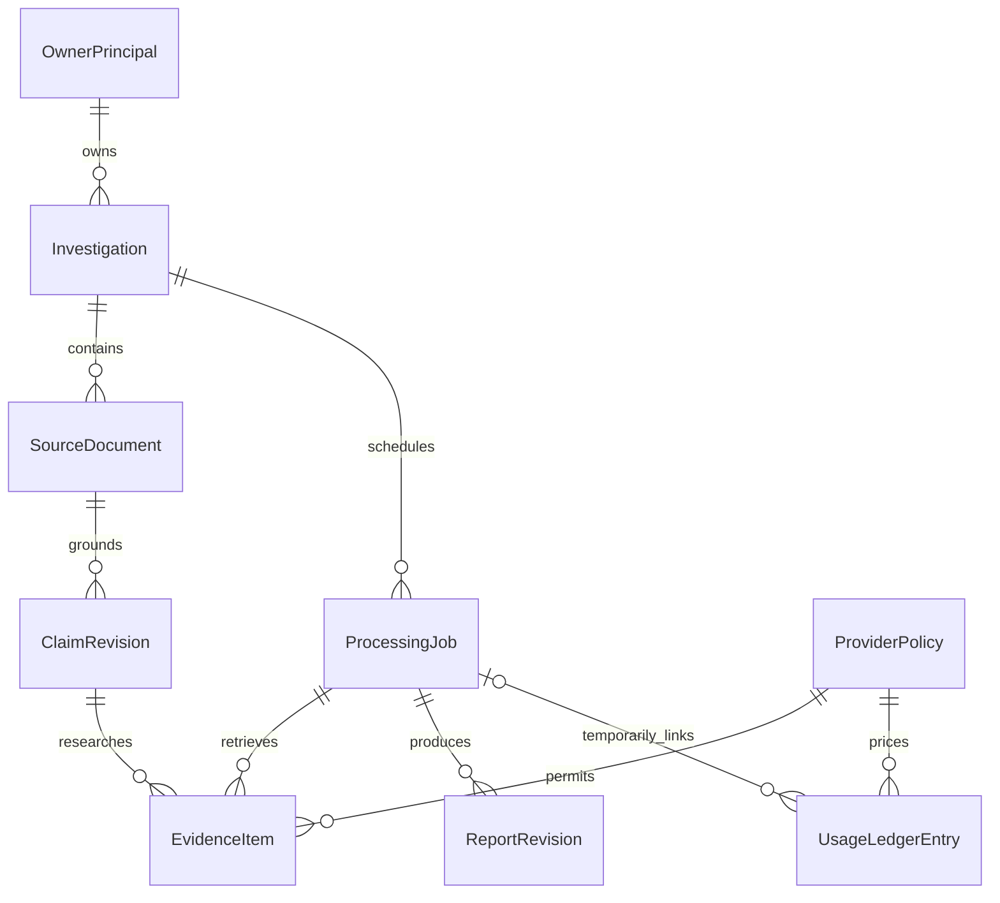

# Data Contracts — Research Evidence Workbench

Related: [SRS](SRS.md) · [Architecture](ARCHITECTURE.md)
Status: Draft proposed contracts for the approved pilot; not implemented API documentation.

## 1. Conventions

- JSON fields: `snake_case`; entity names: PascalCase; REST paths: lowercase hyphenated segments under `/api/v1`. Existing public/video APIs are legacy, not these contracts.
- Identifiers: opaque UUID strings generated by the server; no video ID or title acts as a private-resource identifier.
- Time: ISO 8601 UTC timestamps with `Z`; duration/source cue times in non-negative decimal seconds. Unknown times remain null.
- Text: UTF-8. Word count is the number of nonempty whitespace-separated tokens in parsed source text. Character offsets count Unicode code points and use half-open ranges `[start, end)` in `normalized_text`; they are not UTF-16 JavaScript indices.
- Money: non-negative integer USD microdollars (`1 USD = 1,000,000 usd_micros`); do not use binary floats for admission/accounting. Prices have a version/date and provider/account scope.
- Required fields are non-null unless their type explicitly permits null. Optional means absent is permitted. All supplied/retrieved text is untrusted data.
- Proposed API mechanisms implement approved behavior; stakeholder product decisions remain in SRS. Authentication format, numeric byte/token ceilings, and account-specific policies remain SRS TBDs.

## 2. Versioning and compatibility

All entities and operations begin at v1.0.0. Additive optional fields are minor changes; field removal, new required fields, or meaning/type changes are major changes. Export consumers ignore unknown fields; mutation endpoints reject unknown writable fields so server-owned fields cannot be overwritten.

No compatibility promise or deprecation window is approved for legacy video APIs. The new pilot contract uses a separate namespace and database boundary; it does not silently reinterpret old public reports as private source documents. Before a future released contract is changed incompatibly, a migration/deprecation period must be agreed and documented here.

## 3. Entities

Common investigation-content fields: `id: uuid`, `investigation_id: uuid` where applicable, `created_at: timestamp`, and server-resolved ownership through ENT-002. All have active retention bounded by ENT-002 `expires_at` and earlier FR-014 deletion. Foreign keys cannot bypass owner/expiry checks.

### ENT-001 — OwnerPrincipal (v1.0.0)

The single allowed pilot identity. System of record: CMP-002 through CMP-006. Account/session retention: TBD-006, independent of investigation retention.

| Field | Type | Required | Constraints | Classification | Description |
|---|---|---|---|---|---|
| id | uuid | yes | Server-set | internal | Owner key |
| auth_subject | string | yes | Unique configured subject; scheme TBD-008 | PII | Authenticated identity binding |
| enabled | bool | yes | Operator-controlled | internal | Whether owner access is permitted |
| created_at | timestamp | yes | Server-set | internal | Provisioning time |

Relationships: one owner owns ENT-002 records. Session secrets live in the chosen authentication mechanism, not exports or model prompts. No public self-registration is part of the pilot.

### ENT-002 — Investigation (v1.0.0)

Private research case. System of record: CMP-006. Retention: FR-014/FR-015.

| Field | Type | Required | Constraints | Classification | Description |
|---|---|---|---|---|---|
| id | uuid | yes | Immutable | internal | Case identifier |
| owner_id | uuid | yes | ENT-001 | internal | Sole authorized owner |
| title | string | yes | Nonempty; byte bound TBD-005 | confidential | Owner label; not an inferred video title |
| created_at | timestamp | yes | Server-set | internal | Retention origin |
| expires_at | timestamp | yes | Proposed `created_at + 30 days`; FR-015 | internal | Fixed expiration |
| revision | int | yes | Positive monotonic optimistic-lock version | internal | Content mutation guard |

Invariants: expiration blocks access and execution even before purge runs; expiration is not refreshed by edits. Deletion invalidates active jobs before success is returned. The deletion transaction removes content-bearing descendants and disconnects content-free accounting identifiers. Physical SQLite page/WAL handling and backup purge are TBD-006 implementation decisions; logical row removal alone is not a promise of erasure from every copy.

### ENT-003 — SourceDocument (v1.0.0)

Immutable supplied material. System of record: CMP-006; produced by CMP-003.

| Field | Type | Required | Constraints | Classification | Description |
|---|---|---|---|---|---|
| id / investigation_id / created_at | common | yes | Active parent required | internal | Common fields |
| format | enum | yes | `text`, `txt`, `srt`, `vtt` | internal | Parser mode |
| original_name | string/null | yes | Basename only; no file path | confidential | Uploaded name; null for pasted text |
| original_text | string | yes | Decoded UTF-8 input, unchanged | confidential | Submitted representation |
| content_sha256 | string | yes | SHA-256 of accepted original UTF-8 bytes | internal | Input identity |
| normalized_text | string | yes | Readable parsed text; <= NFR-002 word limit | confidential | Offset reference representation |
| word_count | int | yes | Server-calculated | internal | Capacity check |
| segments | SourceSegment[] | yes | Empty allowed only for un-timed text | confidential | Transcript locations/times |
| source_label | string | yes | User-provided | confidential | Provenance description |
| source_url | string/null | yes | Optional HTTP(S) reference; never fetched by ingestion | confidential | Context link |
| source_date / speaker | string/null | yes | User-supplied or unknown; not inferred as fact | confidential | Known context |
| acquisition_basis | enum | yes | `own_material`, `licensed`, `permission`, `other_lawful_basis` | confidential | Declared basis |
| basis_note | string/null | yes | Required for other-lawful-basis | confidential | Owner explanation; not legal verification |
| authorized_to_process | bool | yes | Must be true | internal | Eligibility attestation |
| confidentiality | enum | yes | `public`, `non_confidential` | internal | Accepted pilot scope |

`SourceSegment = {index: int, text: string, text_start: int, text_end: int, start_seconds: decimal|null, end_seconds: decimal|null}`. Cue times retain the parsed source values; `end_seconds >= start_seconds` when present. TXT/paste may use one untimed segment. VTT cue identifiers/style metadata do not become invented spoken claims. Parser normalization preserves an inspectable original and mapping to parsed text; final supported markup/encoding behavior is TBD-005.

Relationships: ENT-002 1..* ENT-003; ENT-003 0..* ENT-004. Replacing input creates another document ID instead of mutating the source referenced by existing claims.

### ENT-004 — ClaimRevision (v1.0.0)

Candidate claim with researcher-editable wording and immutable provenance. System of record: CMP-006.

| Field | Type | Required | Constraints | Classification | Description |
|---|---|---|---|---|---|
| id / investigation_id / created_at | common | yes | Active parent required | internal | Revision identifier |
| claim_id | uuid | yes | Stable across edits | internal | Logical claim identity |
| revision | int | yes | Positive, immutable per row | internal | Wording version |
| document_id | uuid | yes | ENT-003 | internal | Source identity |
| text | string | yes | Nonempty; edit does not alter source quote | confidential | Standalone proposed/corrected proposition |
| source_quote | string | yes | Exact slice of referenced parsed source text | confidential | Original wording |
| source_location | SourceLocation | yes | Valid source offsets/segments | confidential | Inspectable origin |
| context_note | string/null | yes | User/model note labeled as such | confidential | Caveats |
| author | enum | yes | `model`, `owner` | internal | Who produced this wording |

`SourceLocation = {text_start: int, text_end: int, segment_indexes: int[], timestamp_seconds: decimal|null}`. All indices belong to the same immutable source. An extraction with no exact locatable quote does not retain that candidate as grounded. Selection is an ENT-008 snapshot of revision IDs, not a mutable list that can change beneath a running job.

### ENT-005 — EvidenceItem (v1.0.0)

Evidence permitted for the intended report workflow. System of record: CMP-006; CMP-005 filters provider output before persistence.

| Field | Type | Required | Constraints | Classification | Description |
|---|---|---|---|---|---|
| id / investigation_id / created_at | common | yes | Active parent required | internal | Common fields |
| job_id / claim_revision_id | uuid | yes | Same active investigation | internal | Research snapshot |
| provider_policy_id | uuid | yes | ENT-007 policy snapshot reference | internal | Intended-use basis |
| url | string | yes | Valid HTTP(S); no embedded credentials | confidential | Identified source |
| title / publisher | string/null | yes | Permitted metadata only | confidential | Source attribution |
| published_at / retrieved_at | timestamp/null, timestamp | yes | Unknown publication date stays null | internal | Temporal context |
| kind | enum | yes | `web_context`, `professional_fact_check` | internal | Retrieval type |
| retained_passage | string/null | yes | Only when policy/content basis permits | confidential | Evidence available for quote validation |
| passage_sha256 | string/null | yes | Present if retained passage exists | internal | Passage identity |
| coverage | enum | yes | `snippet`, `page_chunk`, `full_document` | internal | Extent actually retrieved |
| original_rating / original_review_date | string/null | yes | Fact-check metadata when permitted | confidential | Publisher verdict, not ours |
| retain_until | timestamp | yes | Minimum of parent expiry and applicable policy limit | internal | Evidence expiration |

Invariants: missing permissions do not default to “allowed”; third-party content rights remain distinct from API plan rights. A provider must not be enabled for a saved-report path unless the needed conclusions, references, and validation material can be retained/exported appropriately. Expired/revoked evidence is removed or withheld from current views/exports, and dependent reports are marked evidence-unavailable rather than falsely implying reproducibility. Any bounded permitted metadata surviving an excerpt purge follows the recorded policy.

### ENT-006 — ReportRevision (v1.0.0)

Immutable generated or edited report snapshot. System of record: CMP-006.

| Field | Type | Required | Constraints | Classification | Description |
|---|---|---|---|---|---|
| id / investigation_id / created_at | common | yes | Active parent required | internal | Revision identity |
| report_id / revision | uuid, int | yes | Stable logical ID; monotonic revision | internal | Version lineage |
| parent_revision_id | uuid/null | yes | Same report lineage | internal | Previous version |
| research_job_id | uuid | yes | ENT-008 | internal | Frozen research inputs |
| summary / researcher_notes | string | yes | May be empty | confidential | Draft/researcher text |
| assessments | ClaimAssessment[] | yes | Referenced claim/evidence belongs to snapshot | confidential | Findings |
| review_state | enum | yes | `draft`, `reviewed` | internal | Editorial state |
| reviewed_by / reviewed_at | uuid/null, timestamp/null | yes | Both set only for reviewed state | internal | Owner review |
| author | enum | yes | `model`, `owner` | internal | Origin |
| model_id / prompt_version | string/null | yes | Retained for generated base | internal | Generation provenance |

`ClaimAssessment = {claim_revision_id: uuid, assessment: supported|contradicted|mixed|insufficient_evidence|non_factual, explanation: string, limitations: string[], citations: Citation[]}`.

`Citation = {evidence_id: uuid, quote: string, stance: supports|contradicts|context, quote_match: validated, context_review: not_reviewed|reviewed}`. `validated` only means the quote matches actual received evidence; it is not a truth or contextual-support certificate. The retained report records external-research failures/limitations. Any edit creates a new draft revision unless the owner explicitly confirms review for the resulting revision. Owner-created uncited conclusions remain clearly researcher judgments and cannot masquerade as validated AI evidence.

### ENT-007 — ProviderPolicy (v1.0.0)

Dated intended-use and price configuration. System of record: CMP-005 configuration, persisted reference through CMP-006. Retention: non-content configuration/history; TBD-006.

| Field | Type | Required | Constraints | Classification | Description |
|---|---|---|---|---|---|
| id / version / verified_at | uuid, string, timestamp/null | yes | Immutable policy versions | internal | Reference snapshot |
| provider / account_scope | string | yes | Operator-defined | internal | Integration/billing boundary |
| enabled | bool | yes | False until required facts established | internal | Operation gate |
| entitlement_reference | string/null | yes | Contract/plan reference, no secrets | internal | Verification record |
| processing_allowed / report_retention_allowed / export_allowed | bool | yes | No implicit true default | internal | Intended-use decisions |
| permitted_fields | string[] | yes | Explicit field allowlist | internal | Persistable/exportable data |
| passage_ttl_seconds | int/null | yes | Null cannot be interpreted as unlimited without permission | internal | Retention bound |
| attribution_requirements | string[] | yes | May be empty if actually permitted | internal | Required attribution |
| price_schedule | object | yes | Integer unit prices, currency USD, dated version | internal | Model tokens/cache and search request rates |
| disclosure | string | yes | Exact configured processing/retention notice | internal | Owner-facing notice |

Credentials are referenced through the existing environment/secret mechanism, never stored in this exported contract. Backend price schedules must account for token/cache/retry categories actually used; an unknown category blocks admission. Policy flags record a reviewed basis, not an automated finding of legal compliance.

### ENT-008 — ProcessingJob (v1.0.0)

Durable extraction/research state. System of record: CMP-006; executor CMP-004.

| Field | Type | Required | Constraints | Classification | Description |
|---|---|---|---|---|---|
| id / investigation_id / created_at | common | yes | Active parent required | internal | Job identity |
| kind | enum | yes | `extraction`, `research` | internal | Stage requested |
| document_id | uuid | yes | One immutable document per job | internal | Source snapshot |
| selected_claim_revision_ids | uuid[] | yes | Empty for extraction; 1–10 for research | internal | Frozen selection |
| status | enum | yes | Defined below | internal | Durable outcome |
| stage | string | yes | Controlled category, no raw errors | internal | Progress location |
| completed / total | int | yes | `0 <= completed <= total` | internal | Work counters |
| started_at / finished_at | timestamp/null | yes | Server-set | internal | Timing |
| request_key / request_hash | string | yes | Owner-scoped idempotency binding | internal | Duplicate protection |
| provider_policy_ids | uuid[] | yes | Dated ENT-007 snapshots used for admission | internal | Rights/price provenance |
| operation_plan | object[] | yes | Bounded categories/counts/max output and retry allowances; no prompt/query text | internal | Complete paid-work plan |
| max_reserved_usd_micros | int | yes | Sum of admitted ENT-009 reservation bounds | internal | Job spending ceiling |
| lease_generation | int | yes | Monotonic fencing generation | internal | Reject stale executors |
| error_code / safe_message | string/null | yes | Error model; redacted | internal | Outcome explanation |

States: `queued -> running -> completed|partial|failed|interrupted|cancelled`. Before starting, queued work can be refused/cancelled for expired content, disabled provider, or funds unavailable. A rejected API admission need not create a job. Admission reserves the complete bounded operation plan; execution consumes those reservations rather than adding unplanned calls. Policy/pricing changes require a valid re-rated plan within the allowance before further calls. `completed` requires every selected item to have an explicit outcome, including genuine insufficient evidence; provider failures with incomplete coverage produce `partial` or `failed`. Restarted ambiguous paid work becomes `interrupted`, not automatically replayed. Explicit resubmission makes a new job and new budget reservations. Investigation deletion removes the content-bearing job row; ENT-009 remains content-free.

### ENT-009 — UsageLedgerEntry (v1.0.0)

Accounting record independent of source content. System of record: CMP-006.

| Field | Type | Required | Constraints | Classification | Description |
|---|---|---|---|---|---|
| id / created_at | uuid, timestamp | yes | Server-set | internal | Entry identity |
| budget_period | string | yes | UTC calendar month for application admission | internal | Monthly bucket |
| operation_id | uuid | yes | Unique billable-attempt key | internal | Deduplication/reconciliation |
| job_id | uuid/null | yes | Set null on investigation deletion | internal | Temporary association |
| provider_policy_id | uuid | yes | Price/policy version reference | internal | Cost provenance |
| reservation_usd_micros | int | yes | Non-negative bounded reservation | internal | Withheld funds |
| incurred_usd_micros | int/null | yes | Null for unresolved billable usage | internal | Known incurred amount |
| state | enum | yes | `reserved`, `settled`, `uncertain` | internal | Reconciliation state |
| usage_counters | object | yes | Token/cache/request counts only | internal | No claim, query, URL, or passage text |

No raw input/evidence/query or credential fields are allowed. Current period admission totals include known incurred charges and conservative unresolved reservations. Reservations are released only on evidence that the amount was not incurred or on settlement. Deleted investigations cannot reset those totals. Ledger retention after billing reconciliation is TBD-006.

### 3.10 Entity relationship overview



Every content entity also belongs to ENT-002 even where the diagram omits that edge. Deletion disconnects ledger links rather than retaining content-bearing job references.

## 4. Operations (APIs)

Common rules: authenticated configured owner; no anonymous content responses; expired/deleted/unknown resources return the same non-disclosing 404 behavior. Mutations require session-bound CSRF validation. JSON outputs use the error model in §5. Server authorization derives owner identity; clients cannot assign `owner_id`. Accepted asynchronous jobs return 202 with `job_id` and status URL. Polling interval/backoff and numeric login/request throttles are implementation parameters to settle with SRS TBD-003/TBD-008.

### API-001 — Establish owner session (v1.0.0)

Style: REST. Endpoint: `POST /api/v1/session`. Auth: configured owner authentication method, SRS TBD-008.
Request: method-specific credential/assertion fields, deliberately unresolved; no public signup.
Response: 200 `{owner_id, expires_at, csrf_token}` and an HttpOnly session cookie; credentials are never returned.
Errors: 401 `authentication_failed`; 429 `rate_limited`; generic messages do not enumerate accounts.
Idempotency / pagination / rate limit: session establishment is not a paid operation; throttling/recovery method TBD-008.
Satisfies: FR-001, NFR-005.

### API-002 — End session (v1.0.0)

Style: REST. Endpoint: `DELETE /api/v1/session`. Auth: owner session and CSRF.
Request: no body. Response: 204; invalidate the server session and clear cookie.
Errors: CSRF/auth errors for invalid mutations.
Idempotency / pagination / rate limit: repeated valid logout is harmless; no pagination.
Satisfies: FR-001, NFR-005.

### API-003 — Inspect session (v1.0.0)

Style: REST. Endpoint: `GET /api/v1/session`. Auth: owner.
Request: none. Response: 200 `{owner_id, expires_at, csrf_token}`; 401 when unauthenticated.
Idempotency / pagination / rate limit: read-only, no pagination.
Satisfies: FR-001.

### API-004 — Create investigation (v1.0.0)

Style: REST. Endpoint: `POST /api/v1/investigations`. Auth: owner and CSRF.
Request: `{title: string}` with `Idempotency-Key` header.
Response: 201 ENT-002 owner view. Errors: 422 `invalid_input`, 409 `idempotency_conflict`.
Idempotency / pagination / rate limit: same owner/key/body returns same investigation while retained; same key/different body conflicts.
Satisfies: FR-002, FR-015.

### API-005 — Retrieve investigations (v1.0.0)

Style: REST. Endpoints: `GET /api/v1/investigations`, `GET /api/v1/investigations/{id}`. Auth: owner.
Request: list uses optional opaque `cursor` and bounded `limit`; ceiling TBD-005. Detail uses opaque ID.
Response: list `{items: InvestigationSummary[], next_cursor: string|null}`; detail ENT-002 plus child identifiers/counts, not automatically the full transcript.
Errors: 404 `not_found`; 422 `invalid_input`.
Idempotency / pagination / rate limit: read-only; deterministic `(created_at, id)` ordering; expired content excluded.
Satisfies: FR-002, FR-015.

### API-006 — Import source (v1.0.0)

Style: REST. Endpoint: `POST /api/v1/investigations/{id}/documents`. Auth: owner and CSRF.
Request: multipart form with exactly one `text` or `file`, `format`, `source_label`, optional reference/context fields, `acquisition_basis`, optional `basis_note`, `authorized_to_process=true`, and permitted `confidentiality`.
Response: 201 source metadata and parser preview; no provider call. Errors: 413 `input_too_large`, 422 `malformed_transcript`/`unsupported_format`/`ineligible_material`, 404 `not_found`.
Idempotency / pagination / rate limit: `Idempotency-Key` binds the accepted input hash and metadata; byte/word ceilings checked before persistent acceptance; no archive/media inputs.
Satisfies: FR-003–FR-005, NFR-002, CON-004.

### API-007 — Retrieve source (v1.0.0)

Style: REST. Endpoint: `GET /api/v1/documents/{id}`. Auth: owner.
Response: 200 ENT-003 owner view. Errors: 404 `not_found`.
Idempotency / pagination / rate limit: read-only; never redirects to/fetches `source_url`.
Satisfies: FR-003, FR-005.

### API-008 — Request extraction (v1.0.0)

Style: REST. Endpoint: `POST /api/v1/documents/{id}/extractions`. Auth: owner and CSRF.
Request: `{expected_investigation_revision: int, processing_disclosure_version: string}`; `Idempotency-Key` required.
Response: 202 job reference. Errors: 409 `stale_revision`, 402 `budget_exhausted`, 503 `provider_not_enabled`/`pricing_unavailable`, 404 `not_found`.
Idempotency / pagination / rate limit: replay cannot create another paid job; reserve/admit atomically; NFR-001 executor limit applies.
Satisfies: FR-006, FR-016, FR-017, NFR-007.

### API-009 — Retrieve or revise claims (v1.0.0)

Style: REST. Endpoints: `GET /api/v1/documents/{id}/claims`, `PATCH /api/v1/claims/{claim_id}`. Auth: owner; CSRF for PATCH.
Request PATCH: `{expected_revision: int, text: string, context_note?: string|null}`. Original quote/document/location are not writable.
Response: GET claim revisions/current view; PATCH new ENT-004 revision. Errors: 409 `stale_revision`, 422 `invalid_input`, 404 `not_found`.
Idempotency / pagination / rate limit: optimistic concurrency; no external calls on wording edits; selection is supplied to API-011.
Satisfies: FR-005, FR-007.

### API-010 — Retrieve job status (v1.0.0)

Style: REST. Endpoint: `GET /api/v1/jobs/{id}`. Auth: owner.
Response: 200 redacted ENT-008 status plus generated claim/report references if available. Errors: 404 `not_found`.
Idempotency / pagination / rate limit: read-only polling; no provider requests triggered by polling.
Satisfies: FR-006, FR-016, NFR-003.

### API-011 — Request selected-claim research (v1.0.0)

Style: REST. Endpoint: `POST /api/v1/investigations/{id}/research-jobs`. Auth: owner and CSRF.
Request: `{document_id, selected_claim_revision_ids: uuid[1..10], expected_investigation_revision: int, processing_disclosure_version: string}`; `Idempotency-Key` required. All claims must belong to the selected source/parent.
Response: 202 job reference. Errors: 422 `invalid_selection`, 409 `stale_revision`/`idempotency_conflict`, 402 `budget_exhausted`, 503 `provider_not_enabled`/`pricing_unavailable`, 404 `not_found`.
Idempotency / pagination / rate limit: immutable snapshot; repeated same key cannot repeat paid research; NFR-001 applies; policy checked at admission and each provider call.
Satisfies: FR-007, FR-008, FR-016, FR-017, NFR-001, NFR-002, IR-002.

### API-012 — Retrieve or revise report (v1.0.0)

Style: REST. Endpoints: `GET /api/v1/investigations/{id}/reports`, `GET /api/v1/reports/{revision_id}`, `POST /api/v1/reports/{revision_id}/revisions`. Auth: owner; CSRF for POST.
Request POST: `{expected_revision, summary, researcher_notes, assessments, confirm_review: bool}`. IDs, source passages, validated match flags and provider rights are not client-writable. Citation changes are revalidated.
Response: report list, selected ENT-006 view, or 201 new revision. Errors: 409 `stale_revision`, 422 `invalid_citation`/`invalid_input`, 404 `not_found`.
Idempotency / pagination / rate limit: revision creation uses `Idempotency-Key`; no external research unless separately initiated.
Satisfies: FR-009–FR-012, NFR-004.

### API-013 — Export report revision (v1.0.0)

Style: REST. Endpoint: `GET /api/v1/reports/{revision_id}/export?format=markdown|json`. Auth: owner.
Request: explicit export action/format. Response: attachment with Markdown or ExportEnvelope below; `Cache-Control: no-store`.
Errors: 422 `unsupported_format`, 409 `export_not_permitted` when a useful authorized report cannot be generated, 404 `not_found`.
Idempotency / pagination / rate limit: read-only generation; no permanent server-side export copy or hosted share link; evidence policies rechecked at export time.
Satisfies: FR-013, NFR-004, IR-002, CON-003.

`ExportEnvelope v1.0.0 = {contract_version, exported_at, investigation: {id, title, expires_at}, report: {id, report_id, revision, review_state, reviewed_at, summary, researcher_notes, assessments}, claims: ClaimExport[], evidence: EvidenceExport[], provenance: {document_ids, source_hashes, model_id, prompt_version}, limitations: string[]}`.

`ClaimExport = {claim_revision_id: uuid, claim_id: uuid, revision: int, document_id: uuid, text: string, source_quote: string, source_location: SourceLocation, source_label: string, source_url: string|null, source_date: string|null, speaker: string|null}`. These are the referenced claim revisions, not every candidate in the investigation.

`EvidenceExport = {evidence_id: uuid, url: string, title: string|null, publisher: string|null, published_at: timestamp|null, retrieved_at: timestamp, kind: string, coverage: string, original_rating?: string|null, original_review_date?: string|null, quoted_passages?: string[], attribution: string[]}`. Include only fields/quotes permitted by the current recorded policy; `quoted_passages` contains validated report citations rather than the complete retained passage. Policy-limited omission is represented in `limitations` and does not alter the publisher's original verdict. The owner/account identity, authentication data, provider credentials, idempotency keys, usage ledger, and original whole input are excluded.

Exports contain cited claim passages/locations and permitted evidence fields, not original whole transcripts or all raw search results. Omitted/restricted/expired evidence is disclosed; quotation validation is not falsely preserved when its evidence is unavailable. Markdown conveys the same review state, references, conclusions, and limitations as JSON. Exports include method/provenance notices and remain labeled AI-assisted. Downloaded copies cannot be recalled by application deletion; the researcher controls distribution.

### API-014 — Delete investigation (v1.0.0)

Style: REST. Endpoint: `DELETE /api/v1/investigations/{id}`. Auth: owner and CSRF.
Request: owner confirmation in UI; no provider deletion guarantee in body.
Response: 204 after active-content deletion and executor fencing. Errors: non-disclosing 404 for missing/expired content; active-storage failure must not return success.
Idempotency / pagination / rate limit: repeated calls reveal no deleted content; polling cannot resume the job; ledger charges remain with `job_id=null`.
Satisfies: FR-014, FR-015, FR-018.

### API-015 — Retrieve budget state (v1.0.0)

Style: REST. Endpoint: `GET /api/v1/budget`. Auth: owner.
Response: `{period, currency: "USD", operating_allowance_usd_micros, variable_allowance_usd_micros, known_incurred_usd_micros, reserved_usd_micros, uncertain_usd_micros, available_usd_micros, price_version, hosting_assumption_usd_micros, reconciled_at: timestamp|null}`. Categories do not double-count the same reservation.
Errors: 503 `pricing_unavailable` if amounts cannot be meaningfully rated; known charges remain visible.
Idempotency / pagination / rate limit: read-only; display distinguishes application records from an external final invoice.
Satisfies: FR-017, FR-018, CON-002.

## 5. Error model

```json
{
  "error": {
    "code": "budget_exhausted",
    "message": "The remaining research allowance cannot cover this operation.",
    "request_id": "opaque-correlation-id",
    "retryable": false,
    "field": null
  }
}
```

Codes used above: `authentication_failed`, `rate_limited`, `invalid_input`, `not_found`, `csrf_failed`, `idempotency_conflict`, `input_too_large`, `malformed_transcript`, `unsupported_format`, `ineligible_material`, `stale_revision`, `invalid_selection`, `invalid_citation`, `budget_exhausted`, `pricing_unavailable`, `provider_not_enabled`, `export_not_permitted`. Job terminal categories additionally include `provider_failure`, `provider_timeout_uncertain`, `interrupted`, and `cancelled`.

Messages are controlled and content-free; raw exception text, provider authentication details, queries, and private filenames are not exposed. `retryable=true` never itself permits an automatic paid retry without admission/reservation. Failed job state is an ENT-008 outcome rather than a successful report containing a misleading “no evidence” result.

## 6. Events and messages

No external messaging broker is proposed. Internal job transitions are persisted in ENT-008 and polled through API-010. These are not public webhooks or a new event-delivery contract. Lease generations and transactionally written status replace assumptions about exactly-once execution; provider calls can still have ambiguous outcomes.

## 7. External integration contracts

| Integration | Sent | Received | Admission/retention rule | Failure behavior |
|---|---|---|---|---|
| Anthropic | Accepted non-confidential source context for extraction; selected claims/context and permitted evidence for assessment | Structured suggestions, model identity, usage counters | Enabled ENT-007; disclosure acknowledged; reserve actual price categories including configured caches/retries | Controlled failure/interruption; no invented assessment; unresolved billed calls remain reserved |
| Brave Search / LLM Context | Claim-derived search queries, not entire transcripts by default | Source URLs/metadata and passages | Account-specific intended-use rights must cover useful retained/exported outputs; no general permission inferred from functioning key | Distinguish failure/no results; disallowed data stays out of persistence/export |
| Google Fact Check Tools | Claim query/filters | Existing professional reviews/ratings/source metadata | Preserve original verdict identity when permitted; respect specific owner/law permission and applicable cache headers | Optional source; record unavailability separately; topic match is not identical-claim verification |

No source-platform extraction, browser cookies, media download, YouTube metadata API, or player integration is needed for the pilot. Retrieved source URLs do not authorize additional page downloads; any later full-page connector needs its own permission and failure contract. No provider SLA is invented. Detailed research and dated official references are in EVIDENCE_PROVIDER_FEASIBILITY.md.

## 8. Data classification, retention, and residency

Application records remain private even when input material is public. `confidential` in the field tables means restricted application data; it does not mean the pilot accepts confidential source material.

| Entity | Classification | Retention | Residency | Deletion rule |
|---|---|---|---|---|
| ENT-001 | PII/internal | Account/session policy TBD-006 | Deployment/auth choice TBD-008 | Disable sessions on logout/revocation; account handling separate from case deletion |
| ENT-002–ENT-004 | Confidential/internal | Parent deadline or earlier user deletion | Existing hosting candidate; actual region unresolved | Active-content purge and access refusal |
| ENT-005 | Confidential/internal | Minimum of parent deadline and source/provider-use bound | Deployment plus disclosed provider handling | Purge/withhold fields and dependent citation availability |
| ENT-006 | Confidential/internal | Parent deadline; earlier rights restrictions apply | Deployment; owner-controlled downloads outside application | Remove retained reports; downloads not recallable |
| ENT-007 | Internal | Configuration/policy history TBD-006 | Operator configuration/deployment | No credentials or private source content |
| ENT-008 | Internal/content references | Parent deadline or earlier deletion | Deployment | Fence and remove; no late writes |
| ENT-009 | Internal, content-free | At least current-period reconciliation; final duration TBD-006 | Deployment | Detach content links; no refund of incurred charges |

Backups, SQLite WAL/page remnants, temporary uploads, and external-provider copies need explicit handling under TBD-006. Expired records are immediately unavailable at request/executor checks; physical cleanup runs at startup, before job execution, and in periodic maintenance while the service runs. On offline restart, purge occurs before private access/work resumes. There is no claim of physical erasure from a stopped external host at an exact instant.

## 9. Migrations and deprecations

| Contract | From → To | Change | Migration | Deprecated until |
|---|---|---|---|---|
| Investigation/source identity | Legacy video ID → ENT-002/ENT-003 | Separate private investigation model | Proposed new pilot tables/database; any historical import requires provenance/rights review | No date assigned; legacy data is not automatically imported |
| Public report API | Existing anonymous routes → owner-only `/api/v1` | Privacy boundary changes | Disable/exclude anonymous legacy content routes in the pilot deployment; preserve existing repository work | Deployment plan not yet authorized |
| Export | No workbench export → v1.0.0 | Versioned reviewed/draft research dossier | New serializer with policy filtering | Initial contract |

No database migration or production change was performed by this documentation task.

## Revision history

| Rev | Date | Commit | Mode | Summary |
|---|---|---|---|---|
| 1 | 2026-10-14T14:40:10-04:00 | 46b1345ef45f | INIT | Proposed ENT-001–ENT-009 and API-001–API-015 for approved private pilot; export, deletion, policy, and usage invariants; documentation-only authorization |
