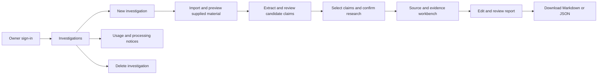

# UI overhaul — Research Evidence Workbench

Status: proposed design and implementation plan for the approved private pilot. The user requested a UI overhaul on 2026-10-14. This document does not describe implemented screens.

Related: [SRS](SRS.md), [Data Contracts](DATA_CONTRACTS.md), [Architecture](ARCHITECTURE.md). Product limits and privacy requirements remain owned by the SRS. Backlog approval also reviews the concrete UI/engineering defaults in §8; it does not approve a deployment.

## 1. Product experience

Make the researcher feel oriented and in control: what material is being checked, which exact claims were selected, what evidence was actually retrieved, what remains uncertain, and what the researcher has reviewed. The main surface becomes a working investigation, replacing the current public video score/report experience.

Use restrained document-oriented styling: warm neutral background, white reading surfaces, charcoal text, indigo actions, and compact metadata. Prioritize source reading and evidence comparison over metric cards, score rings, animations, thumbnails, and promotional copy. Retain the existing light/dark theme mechanism and system fonts; no new frontend framework, font service, illustration subscription, or component-library dependency is proposed.

## 2. Information architecture



Proposed browser routes (separate from versioned backend API routes): `/sign-in`, `/investigations`, `/investigations/new`, `/investigations/{id}/source/{document_id}`, `/investigations/{id}/claims`, `/investigations/{id}/research`, `/investigations/{id}/report`, `/usage`. Paths are implementation proposals, not a requirement for a router dependency. Plain FastAPI pages and small JavaScript modules suffice.

Primary navigation: **Investigations** and **Usage**. Investigation-local navigation: **Source**, **Claims**, **Evidence**, **Report**. Keep title, private status, draft/reviewed state, and expiration visible in the investigation header. Logout is an explicit account action. No public Browse, channel rankings, anonymous report sharing, or automatic URL lookup is part of this navigation.

## 3. Screens and interactions

### UI-001 — Application shell and sign-in

- Compact header with working product name, private workspace label, navigation, theme toggle, and account/logout control.
- Single-owner sign-in; no registration or social-login promises. A session failure returns to sign-in with a safe return destination, never an external redirect.
- If owner authentication is not configured, show a setup-required state and keep content endpoints inaccessible.
- A backend capability state distinguishes service-online from research-enabled. It does not claim that a successful health request proves provider access.
- Source: FR-001, NFR-005, Architecture ADR-003.

### UI-002 — Investigations dashboard

- Title, short explanation, and **New investigation** action.
- Search/filter existing investigations locally or through the owner API as the actual data size requires; pagination follows API-005. Do not invent a large-scale search service.
- Rows show title, created date, expiration date, document count, latest job state, and draft/reviewed state when a report exists.
- Empty state explains which supplied formats are supported and offers the import action. No seeded/demo investigation appears as real owner work.
- Deletion belongs in an explicit row/detail menu with confirmation; do not put a destructive action next to primary navigation without separation.
- Source: FR-002, FR-014, FR-015, API-004–API-005.

### UI-003 — New investigation and import

- Investigation title followed by **Paste text** and **Upload transcript** tabs; accept TXT/SRT/VTT only.
- Persistent helper text: supported formats, word limit, non-confidential/authorized-material scope, and 30-day retention. Show current word count; backend validation remains authoritative.
- File picker plus drag/drop enhancement; everything works without dragging.
- Provenance fields: source label, optional reference URL/date/speaker, acquisition basis and explanation where required. Reference URLs do not trigger requests or previews.
- Required eligibility confirmation is specific to processing rights and non-confidential scope. Avoid legal text that claims a checkbox establishes permission.
- Preview the parsed text and transcript times before extraction; show parser errors with a line/cue location when available. Preserve the input when a correctable validation error occurs.
- Separate **Save source** from **Extract claims**. The first action has no model/search charge. Extraction shows its processing disclosure and bounded cost before the paid action.
- Source: FR-003–FR-006, FR-017, NFR-002, NFR-007, API-006–API-008.

### UI-004 — Candidate-claim review

- Left: source text with the current claim's original passage highlighted. Right: candidate list with a checkbox, editable standalone wording, source location, and context note.
- Show **Selected n / 10** and a clear **Research selected claims** action. The source quote is read-only even when wording is edited.
- Research confirmation identifies selected claims, bounded cost/reservation, model/search recipients, and remaining allowance. Do not start research on selection alone.
- Zero candidates is a valid explicit outcome with a route back to the source. Provider failure is a separate retryable/blocked outcome.
- Save state is visible; optimistic concurrency conflicts preserve local edits for recovery. A running job uses the saved frozen selection rather than unsaved form state.
- Source: FR-005–FR-007, FR-017, NFR-002, API-009, API-011.

### UI-005 — Source/evidence workbench

Desktop reading structure:

```text
Investigation title       Private · Draft       Expires …       Report
Source | Claims | Evidence | Report
┌────────────────┬──────────────────────────┬─────────────────────────┐
│ Selected claims│ Original source passage  │ Evidence for this claim │
│                │ and surrounding context  │                         │
│ Claim 1        │                          │ Supports / Contradicts  │
│ Claim 2        │ Standalone claim wording │ / Context               │
│ Claim 3        │ Proposed assessment      │ Publisher · date · link │
│                │ Limitations              │ Retrieved passage       │
│ 3 of 10        │ Researcher notes         │ Coverage + quote status │
└────────────────┴──────────────────────────┴─────────────────────────┘
```

- Claim list is compact and keyboard navigable. Selecting a claim aligns source passage, assessment, and evidence.
- Evidence cards show publisher/title, direct link, publication date if known, retrieval date, and coverage: snippet, page chunk, or full document. Unknown dates stay unknown.
- Separate supporting, conflicting, and contextual evidence with labels and icons; color is secondary. Preserve a professional fact-checker's original verdict and attribution separately from the model's suggestion.
- **Quote matched** means a match to retrieved text; **Context reviewed** means researcher review. Never present either as a guarantee of truth.
- Show permitted missing/expired evidence as unavailable with its effect on the report; do not leave a convincing-looking validated citation behind a missing passage.
- Keep source URLs as ordinary links, not an embedded player, screenshot scraping surface, or silent full-page fetch.
- Source: FR-005, FR-008–FR-010, FR-012, IR-002, API-010–API-012.

### UI-006 — Report editor and export

- Reading-first report with source/provenance summary, claim findings, evidence references, limitations, and editable researcher notes.
- Prominent **Draft — AI-assisted** or **Reviewed by researcher** label. No overall video/channel truth percentage.
- Visible save/revision state; editing a reviewed report creates a draft. **Mark reviewed** explicitly confirms the resulting revision.
- Export menu offers Markdown and JSON for the selected revision. Draft export remains labeled unreviewed. Show policy omissions and unavailable citations before export; deny an export that cannot produce a useful permitted report.
- Sharing copy explains that the owner distributes downloaded files; no “Copy public link” action exists.
- Source: FR-011–FR-013, NFR-004, CON-003, API-012–API-013.

### UI-007 — Job progress and recovery

- Stage labels: queued, extracting, retrieving evidence, assessing, preparing draft; use completed/total items where known.
- Show elapsed time, not a fabricated completion percentage or ETA. One executing paid job; queued jobs remain visibly queued.
- Distinguish completed, partial, failed, interrupted, and cancelled. Partial results show exactly which claims lack completed research.
- A retry/resubmit action displays a new budget check and selected source/claims; it does not silently replay ambiguous paid work.
- Deleted/expired source state stops polling and removes private content from the interface. Expired sessions do not trigger a storm of background retries.
- Source: FR-016–FR-018, NFR-001, API-010.

### UI-008 — Usage, retention, and deletion

- Usage page shows the operating allowance, configured variable allowance, known charges, reservations, uncertain amounts, and remaining research funds. Clearly distinguish estimates from external invoices.
- State whether research is ready, disabled pending provider rights/configuration, blocked by unknown pricing, or paused for budget. Keep ordinary review/export available when only the research allowance is exhausted.
- Explain which submitted context reaches the model and which claim queries reach search providers. Expose no keys, credentials, raw provider errors, or account secrets.
- Deletion confirmation names the investigation and explains active application removal, cancellation, surviving content-free cost records, and external/downloaded-copy limits. Do not promise recall of exported files.
- Show expiration before it happens. Do not implement an undeclared sliding retention window or “extend forever” action.
- Source: FR-014–FR-018, NFR-006–NFR-007, API-014–API-015.

## 4. Visual system and reusable components

Proposed system, to review through the backlog approval:

| Element | Direction |
|---|---|
| Typography | Existing system sans; 15–16px UI body, 16–18px reading text, line-height about 1.6 for documents; do not fetch external fonts |
| Layout | Generous document reading space; compact controls/metadata; text columns normally 60–80 characters wide |
| Light palette | Existing warm neutral/white/charcoal base; existing indigo action/focus color; validate actual contrast before shipping |
| Dark palette | Existing charcoal surfaces and light text; independently verify borders, disabled states, and assessment labels |
| Spacing | Shared 4/8/12/16/24/32px scale; consistent form/error/action placement |
| Shape | 8–12px corners for controls/panels; restrained shadows; no glass/gradient dependency |
| States | Draft/reviewed, source coverage, support/contradiction, job state, budget state, and retention each have distinct text labels |
| Components | Shell/navigation; form field/error; import panel; investigation row; claim row/editor; source viewer; evidence card; progress banner; report editor; export menu; confirmation dialog; empty/error state |
| Motion | Short feedback transitions only; honor reduced-motion; no looping processing animation needed |

Breakpoints proposed for implementation: three columns at >=1280px; claim list plus one reading pane at 768–1279px; stacked tabs/panels below 768px. Match the task to available space without hiding the original quote or evidence coverage. These are design choices, not invented usage/performance promises.

## 5. Accessibility, responsiveness, and interaction checks

Propose WCAG 2.2 AA as the target for core pilot flows, subject to backlog approval; there is no current conformance claim. Use semantic controls, visible labels, programmatically associated errors, keyboard operation, focus restoration in dialogs, and status announcements that do not repeat every poll. Sticky headers must not hide keyboard focus. Follow [W3C WCAG 2.2](https://www.w3.org/TR/WCAG22/).

Verify the agreed browser matrix at implementation time. Proposed matrix: current stable Chromium for automated coverage, with Firefox and WebKit core-flow smoke tests when installed; desktop remains primary. Test layouts at 1440, 1024, 768, and 390 CSS pixels, zoom/reflow, both themes, and reduced motion. Mobile must support reading, basic edits, and export without pretending it is the preferred dense-comparison environment.

No test may rely on color alone or a matching screenshot to establish meaningful research correctness. Browser checks must cover actual authentication and the private supplied-material journey using clearly labeled fixtures, plus separately permitted live-provider trials for capability/cost.

## 6. Current UI migration map

| Existing files | Proposed reuse/change | Limit |
|---|---|---|
| `frontend/styles.css`, `common.js`, `theme-init.js` | Retain useful tokens/theme/escaping/focus utilities; split readable workbench components as needed | Avoid a cosmetic rewrite of unrelated legacy screens |
| `frontend/index.html`, `home.js` | Add private sign-in/dashboard entry through an explicit pilot mode or routes | No silent change to the current public deployment |
| `frontend/claims.js`, `report.js`, `video.html` | Reuse inspectable claim/evidence patterns and safe rendering | Remove score/player/public-link assumptions in workbench modules |
| `frontend/videos.html`, `browse.js`, `channel.html`, `channel.js` | Historical public experience; not pilot navigation | Private pilot must not expose anonymous historical routes/data |
| `tests/e2e/test_frontend.py`, `conftest.py` | Preserve legacy tests; add private fixtures, API guards, lifecycle/export cases | Existing seeded tests do not prove new UI or provider processing |
| `scripts/screenshots.py`, `docs/images/` | Extend after workbench screens exist | Do not relabel old screenshots as the new product |

New module paths listed in tickets are proposed additions, not files claimed to exist. Avoid a framework migration, CDN icons/fonts, an online design dependency, or analytics additions to fulfill this plan.

## 7. Implementation sequence and done criteria

1. Private access boundary and data foundation, with no paid work enabled accidentally.
2. Shared shell and dashboard; supplied-material import/preview.
3. Policy/budget gates and durable job state, then extraction and claim review.
4. Evidence retrieval/assessment and comparison workbench.
5. Revision review/export, deletion/expiration, and usage/disclosure UI.
6. Keyboard/responsive/accessibility pass and representative end-to-end evaluation.

Each screen lands with meaningful integration/browser tests and all applicable empty, loading, validation, unavailable, expired, and error states. A UI ticket is not done because static fixture screenshots look correct. Changes must update implementation docs and verification steps in the same ticket. No ticket may claim research success from a liveness endpoint alone.

## 8. Proposed defaults and remaining decision gates

The backlog approval reviews these concrete engineering choices once as a group:

| Decision | Proposal | Decision ownership |
|---|---|---|
| Owner authentication | One configured owner passphrase; Argon2 password hash through `pwdlib[argon2]`; opaque server-side SQLite sessions; no signup/email/OAuth dependency; operator rotates hash and revokes sessions for recovery | SRS TBD-008; proposed, not implemented |
| Session behavior | Eight-hour maximum session, revoke on logout/credential rotation, Secure/HttpOnly/SameSite cookie, session-bound CSRF, bounded generic login throttling | Security implementation; exact throttle tuned/tested in auth ticket |
| Input bounds | Reject uploads above 1 MiB before buffering, reject invalid UTF-8/unsupported formats, keep approved word limit, and enforce a separately estimated provider-token ceiling before paid calls | SRS TBD-005; prototype performance test confirms memory behavior |
| Retention clock | Fixed 30 days from investigation creation; no reset on edit/access | Proposed interpretation already recorded in FR-015 |
| Pilot backup model | No automatic content backups initially; explicit exports are owner copies, not an application restore guarantee. Use dedicated SQLite store and verified deletion behavior; disclose host/provider physical-copy limits | SRS TBD-006; loss/recovery trade-off needs backlog approval |
| Ledger/session retention | Content-free usage records through current/previous billing-period reconciliation; expired/revoked sessions promptly purged; operational diagnostics contain no document/query text | Proposed policy detail; final numeric reconciliation window reviewed in accounting ticket |
| Browser/accessibility | Core-flow WCAG 2.2 AA target and browser/layout matrix in §5 | SRS TBD-007; no certification claim |

The authentication dependency is a plan only. Recheck current official documentation and pin a tested version when implementing. FastAPI documents `pwdlib` with Argon2 for hashing; opaque cookie sessions are our architectural choice, not its JWT tutorial copied as a requirement. See [FastAPI password hashing](https://fastapi.tiangolo.com/tutorial/security/oauth2-jwt/), [OWASP session guidance](https://cheatsheetseries.owasp.org/cheatsheets/Session_Management_Cheat_Sheet.html), and [OWASP CSRF guidance](https://cheatsheetseries.owasp.org/cheatsheets/Cross-Site_Request_Forgery_Prevention_Cheat_Sheet.html).

Provider storage/export rights and actual prices remain unresolved facts; approving a backlog cannot establish them. Evidence-provider tickets remain gated on the corresponding recorded decision. Quality/latency targets, topics/languages/corpus, and actual report volume remain visible open evaluation decisions; implementation can proceed on independent private/local features first.
